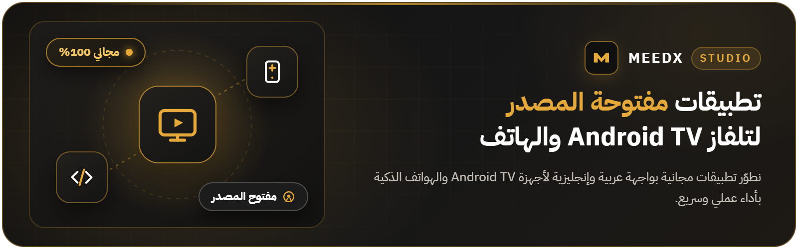
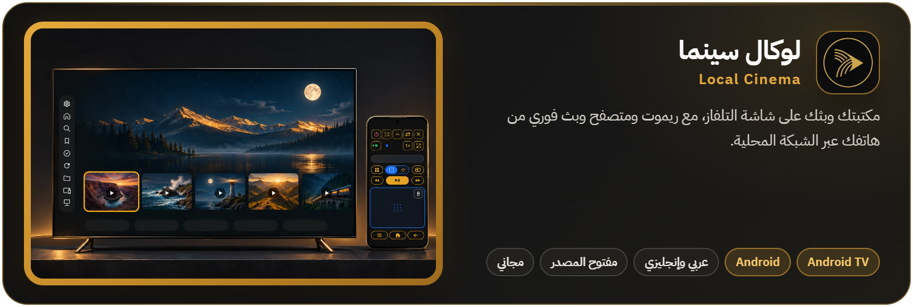

  

  

## أهلاً، نحن MEEDX

نطوّر في MEEDX Studio تطبيقات مفتوحة المصدر ومجانية باللغتين العربية والإنجليزية. نركّز على تقديم تجربة استخدام واضحة وسريعة لأجهزة Android TV وهواتف Android.

## التطبيقات

  

يشغّل Local Cinema مكتبتك المحلية وملفات USB وSMB والإضافات والبث المباشر ووضع الفن على Android TV. يوفّر Local Cinema Manager ريموتاً ومتصفحاً وبثاً للوسائط من الهاتف عبر الشبكة المحلية.

  <a href="https://github.com/alnouri96/local-cinema">المستودع</a>
  &nbsp;·&nbsp;
  <a href="https://meedx.pages.dev/apps/local-cinema">الموقع</a>
  &nbsp;·&nbsp;
  <a href="https://meedx.pages.dev/downloads">تنزيل آخر إصدار</a>
  &nbsp;·&nbsp;
  <a href="https://t.me/MEEDXAPP">قناة تلجرام</a>
  &nbsp;&nbsp;
  

